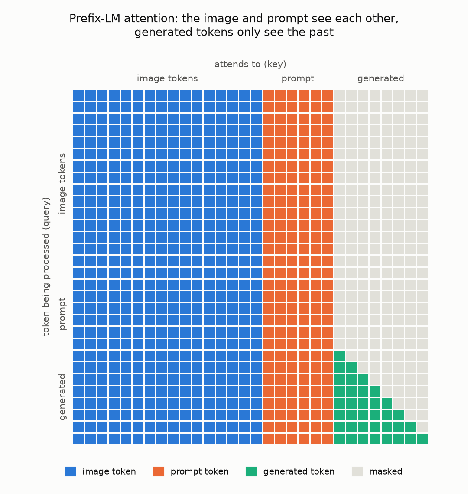

# VLM from scratch

A from-scratch implementation of **PaliGemma** ([Beyer et al., 2024](https://arxiv.org/abs/2407.07726)),
Google's 3B vision-language model, in PyTorch: a SigLIP image encoder, a linear projector and a Gemma
decoder, with KV-cache generation and top-p sampling. It loads the official Hugging Face checkpoint.

With the same weights, it matches the Hugging Face `transformers` implementation: logits agree to ~1e-5 and
greedy generations are token-for-token identical, including batched generation.



## How it works

The image is resized to 224×224 and cut into 14×14 patches. SigLIP turns them into 256 vectors and a linear
layer projects each one into Gemma's 2048-dimensional embedding space. They replace 256 `<image>` placeholder
tokens at the start of the input:

```
<image> × 256   <bos>   prompt   \n   →   generated tokens
```

The image and the prompt form the *prefix*, which uses full (bidirectional) attention: image patches can
attend to the prompt and vice versa. Generated tokens are causal. The figure above is captured from the
model's own masks during `generate()`. Positions are 1-indexed, as in `transformers` ≥ 4.45.

The decoder is Gemma 2B: 18 layers, multi-query attention (8 query heads sharing 1 key/value head,
head_dim 256), rotary position embeddings, RMSNorm with `(1 + w)` scaling and a GeGLU MLP. Gemma multiplies
every input embedding by $\sqrt{2048}$, so the image features are divided by $\sqrt{2048}$ first. The
LM head shares its weights with the token embeddings.

The image only has to be encoded once per prompt. After the prefill step its 256 tokens live in the KV-cache,
and each step feeds a single text token:

```python
def forward(self, input_ids, pixel_values, attention_mask, kv_cache=None):
    inputs_embeds = self.language_model.get_input_embeddings()(input_ids)

    image_features = None
    if kv_cache is None or kv_cache.num_items() == 0:  # prefill only
        image_features = self.multi_modal_projector(self.vision_tower(pixel_values.to(inputs_embeds.dtype)))

    inputs_embeds, attention_mask, position_ids = self._merge_input_ids_with_image_features(
        image_features, inputs_embeds, input_ids, attention_mask, kv_cache)
    return self.language_model(attention_mask=attention_mask, position_ids=position_ids,
                               inputs_embeds=inputs_embeds, kv_cache=kv_cache)
```

## Results

From `pytest -s test_paligemma.py` (CPU, PyTorch 2.15, transformers 4.45.2), against Hugging Face's
`PaliGemmaForConditionalGeneration` with the same weights:

| Check | Result |
|---|---|
| Parameter names and shapes | identical (loads with `strict=True`) |
| Prefill logits, batch of 2 | max \|Δ\| 1.2e-5 (logits up to 7.0) |
| Logits at each of 30 KV-cache decoding steps | max \|Δ\| 3.2e-6 |
| Greedy generation, 30 tokens | identical |
| Batched greedy generation, 3 prompts | identical |
| Image preprocessing vs `SiglipImageProcessor` | within 1e-6 |
| bfloat16 vs float32 | max relative logit error 0.027, same argmax at 96% of positions |

The tests use a tiny model with the same architecture and random weights, so they need no download and run in
a few seconds. The 3B checkpoint is gated and needs ~12 GB of memory in float32.

The tests also check that:

- the vision tower runs exactly once per `generate()` call;
- the loader reads a checkpoint written by `transformers` and ties the LM head to the embeddings;
- the loader raises an error when a weight is missing from the checkpoint;
- bfloat16 loading keeps the rotary frequencies in float32 and restores the default dtype;
- RGBA, grayscale and palette images are processed like their RGB version;
- the prompt string matches `transformers`' format.

`transformers` itself had an off-by-one here in 4.41–4.44: the prefill used 1-indexed positions but decoding
used 0-indexed ones, so the first generated token got the same position as the last prompt token, and
generations drifted after one token. It was fixed in 4.45, so the tests pin `transformers==4.45.2`.

## Running it

```bash
python -m venv .venv
source .venv/bin/activate
pip install -r requirements.txt

pytest -s test_paligemma.py
```

For inference, accept the license on [google/paligemma-3b-pt-224](https://huggingface.co/google/paligemma-3b-pt-224)
and download the checkpoint:

```bash
huggingface-cli login
huggingface-cli download google/paligemma-3b-pt-224 --local-dir paligemma-weights/paligemma-3b-pt-224

python inference.py \
    --model_path paligemma-weights/paligemma-3b-pt-224 \
    --image_file_path my_photo.jpg \
    --prompt "caption en" \
    --dtype bfloat16
```

or `MODEL_PATH=... IMAGE_FILE_PATH=... ./launch_inference.sh`. A GPU (CUDA or Apple MPS) is used
automatically when available; pass `--only_cpu True` to disable it. `--dtype bfloat16` (or `float16`) needs ~6 GB
instead of ~12 GB. `--do_sample True` switches from greedy decoding to top-p sampling (`--temperature`, `--top_p`).

## References

- Beyer, L. et al. *PaliGemma: A versatile 3B VLM for transfer.* 2024. [arXiv:2407.07726](https://arxiv.org/abs/2407.07726)
- Zhai, X. et al. *Sigmoid Loss for Language Image Pre-Training.* 2023. [arXiv:2303.15343](https://arxiv.org/abs/2303.15343)
- Gemma Team. *Gemma: Open Models Based on Gemini Research and Technology.* 2024. [arXiv:2403.08295](https://arxiv.org/abs/2403.08295)
- Su, J. et al. *RoFormer: Enhanced Transformer with Rotary Position Embedding.* 2021. [arXiv:2104.09864](https://arxiv.org/abs/2104.09864)
- Hugging Face reference: [`transformers` PaliGemma](https://github.com/huggingface/transformers/tree/v4.45.2/src/transformers/models/paligemma)
